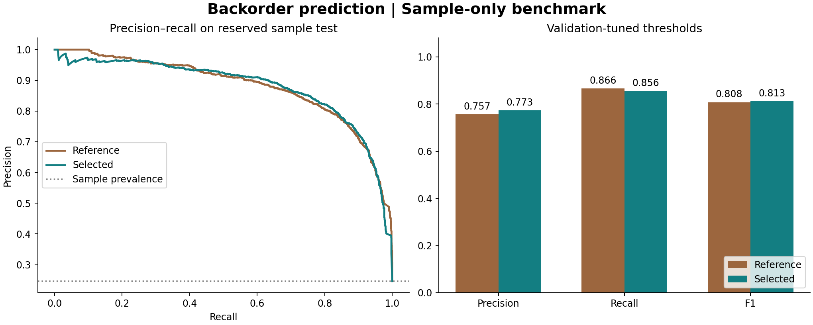

# Product Backorder Prediction
### Turning inventory risk into a manageable review queue

**Hesub Chaka · Python · scikit-learn · Imbalanced classification · Supply chain analytics**

How can a business catch potential shortages without overwhelming its team with false alarms? This project compares three original workflows and adds a reproducible four-candidate improvement experiment with demand-coverage features, grouped data splits, and validation-based threshold selection.



## New experiment: measured improvements

**The engineered Random Forest delivered a modest F1 gain and fewer false alarms on a reserved portion of the supplied sample.** Both models below were trained afresh on the same partition; their thresholds were chosen on validation data before evaluating this partition.

| Sample test metric | Reference Random Forest | Engineered Random Forest |
|---|---:|---:|
| Backorder precision | 75.69% | **77.35%** |
| Backorder recall | **86.63%** | 85.63% |
| F1 | 0.8079 | **0.8128** |
| Average precision | **0.8799** | 0.8780 |
| False alarms | 637 | **574** |
| Missed backorders | **306** | 329 |

That is **9.9% fewer false alarms**, with **23 additional missed backorders**, on the same 9,284 sample test rows. The F1 gain is small, and average precision did not improve. This is a useful tradeoff to investigate, not evidence of broad model superiority or production readiness.

**Scope matters:** this sample has roughly 25% backorders. The original independent test had 1.11%. New sample scores do not replace the historical independent-test precision of 9.75%, and the sample had already been imputed before it was uploaded. A fresh split does not remove that inherited limitation.

## What changed

- Added stock-plus-transit coverage, forecast shortfalls, stocking gaps, sales acceleration, and supplier-performance changes.
- Compared a reference feature-selected Random Forest, an engineered Random Forest, and histogram gradient boosting with and without engineered features.
- Kept identical predictor rows together across train/validation/test partitions.
- Removed anomaly rejection from this experiment so rare shortage patterns are retained.
- Treated supplier-performance `-99` values as missing for engineered candidates, with training-fitted imputation.
- Selected the model by validation average precision and the alert threshold by validation F1. The sample test was inspected after these choices were frozen.

At the selected model's default 0.5 threshold, precision rose to 82.82%, while recall fell to 78.33%. This optional operating point illustrates why a business must specify its tolerance for missed shortages and review workload; it is not the preselected result.

## Explore the project

1. [New model benchmark](notebooks/04_model_improvements.ipynb)
2. [Full experiment record](reports/sample_benchmark.json): splits, versions, candidates, thresholds, confusion matrices, and source hash.
3. [Findings and methodological audit](reports/FINDINGS.md)
4. [Data access and limitations](DATA.md)

## Run the improvement experiment

```bash
pip install -r requirements.txt
python scripts/improve_models.py --sample /path/to/trusted/sample-data.pkl
```

The supplied sample is not redistributed. This command trains four candidates, selects on validation data, evaluates the reference and chosen model on the reserved sample partition, and regenerates the JSON report and figure. It does not use or require the historical independent test CSV. Measured environment versions are in the JSON report. The original experiment follows for context.

---

# Original course experiment

**Hesub Chaka | Machine learning · Supply chain analytics · Imbalanced classification**

Compared three machine learning workflows to identify products at risk of backorder. The central finding is that strong performance on an enriched sample did not translate into high precision at the much lower backorder prevalence in the independent test set.

## Business question

Can inventory, sales forecasts, supplier performance, and product risk flags help prioritize products for inventory review? Missing a backorder can disrupt fulfillment; false alarms can drive unnecessary review and excess stock.

## Data and scope

The supplied course dataset contains 1,687,861 training rows in the recorded output, including an apparently non-product trailing record. Backorders account for 11,293 rows (0.67%). The file contains 23 columns: SKU, 21 usable predictors, and the target. The assignment describes 22 predictors, counting SKU; the model drops that identifier.

The notebooks attribute the dataset to Kaggle but do not identify its original publisher or provide a verified download link. Source provenance and redistribution rights remain unverified. Raw data, sample data, and binary model files are excluded from this repository.

## Approach

1. Remove SKU, encode Yes/No flags, and impute missing values.
2. Keep all 11,293 backorders and sample three non-backorders per positive: 45,172 rows with 25% positive prevalence.
3. Split this sample 80/20 with stratification: 36,137 development rows and 9,035 holdout rows.
4. Compare anomaly detection, feature transformation, and classification workflows using F1-based grid search.
5. Evaluate the selected Random Forest on a separate supplied test file.

| Workflow | Outlier method | Feature method | Classifier | Recorded CV F1 |
|---|---|---|---|---:|
| 1 | Isolation Forest | Scaling + PCA | Logistic regression | 0.635 |
| 2 | Local Outlier Factor | Mutual information selection | Random Forest | 0.823 |
| 3 | Elliptic Envelope | Factor analysis | Gradient boosting | 0.773 |

These are historical recorded scores, not freshly rerun experiments. Outlier filtering precedes cross-validation, so the scores are not fully isolated estimates of the entire workflow.

## Results

Metrics below are recalculated from saved confusion matrices; positive class = backorder.

| Evaluation | Precision | Recall | F1 | False alarms | Missed backorders |
|---|---:|---:|---:|---:|---:|
| Logistic regression, sampled holdout | 50.12% | 90.88% | 0.646 | 2,043 | 206 |
| Random Forest, sampled holdout | 77.62% | 89.33% | 0.831 | 582 | 241 |
| Gradient boosting, sampled holdout | 77.27% | 76.14% | 0.767 | 506 | 539 |
| Random Forest, independent test | 9.75% | 77.08% | 0.173 | 19,179 | 616 |

The selected workflow reduced false alarms by **71.5%** relative to logistic regression on the same sampled holdout, while retaining 89.3% recall. Its F1 improvement was about **0.185 absolute**.

On the independent test, it identified **2,072 of 2,688 backorders** but raised **21,251 alerts**, including 19,179 false alarms. Approximately **9.3 false alarms occurred per correctly identified backorder**. The positive prevalence was only 1.11%, compared with 25% in the development sample. The precision decline is consistent with this prevalence shift; sampling, threshold choice, preprocessing, and possible distribution differences also need investigation.

The test accuracy was **91.82%**, below an always-no-backorder baseline of **98.89%**. That baseline catches zero backorders, illustrating why accuracy alone is an unsuitable success measure here.

## Business recommendation

Treat this as an exploratory prioritization model. The recorded results do not justify automatic purchasing decisions or a claim of cost savings. Validate alert volume against staff capacity, tune thresholds on a separate validation set at realistic prevalence, and compare expected costs of false alarms and missed backorders. Reserve a fresh holdout for the next final assessment.

## Review and limitations

See [the findings and audit](reports/FINDINGS.md) for methodological issues and next steps. No verified feature-importance results are available, so this project does not claim which variables cause backorders.

## Repository guide

- `notebooks/01_preprocessing.ipynb`: preprocessing and sampling.
- `notebooks/02_model_development.ipynb`: three model workflows and sampled comparison.
- `notebooks/03_evaluation.ipynb`: independent-test evaluation.
- `reports/confusion_matrices.json`: transcribed evidence for reported metrics.
- `scripts/summarize_results.py`: dependency-free metric verification.

## Reproduce the report

```bash
python scripts/summarize_results.py
```

This reproduces the arithmetic, not model training. To rerun the historical notebooks, install the packages in `requirements.txt`, obtain the two source CSVs independently, and set `BACKORDER_DATA_DIR` to their directory. Run notebooks in order, using the repository root as the working directory. Expect expensive grid searches and LOF fitting. Dependencies target the new benchmark environment; the historical estimator pickles report scikit-learn 1.7.2 and were not used for the new comparison.

The source CSVs and uploaded pickles are not bundled. Notebook outputs are historical and explicitly labeled. Corrections to imports, variable references, and configurable data paths improve execution readiness; the modeling methodology has not been silently replaced or rerun.

## Attribution

Developed in a University of Missouri Data Science and Analytics course using supplied assignment scaffolding and dataset access. This portfolio edition removes classroom navigation prompts, retains the analysis, and adds a results audit and presentation improvements. No software or dataset license is asserted pending confirmation of ownership and source terms.
