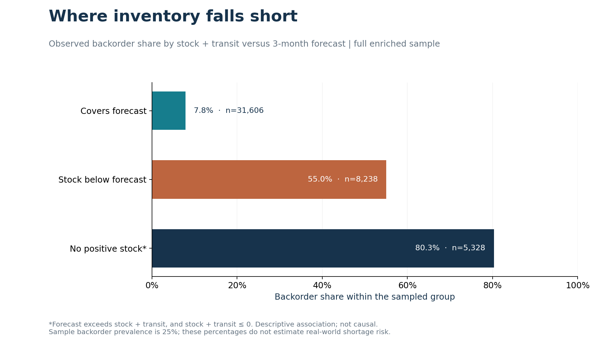
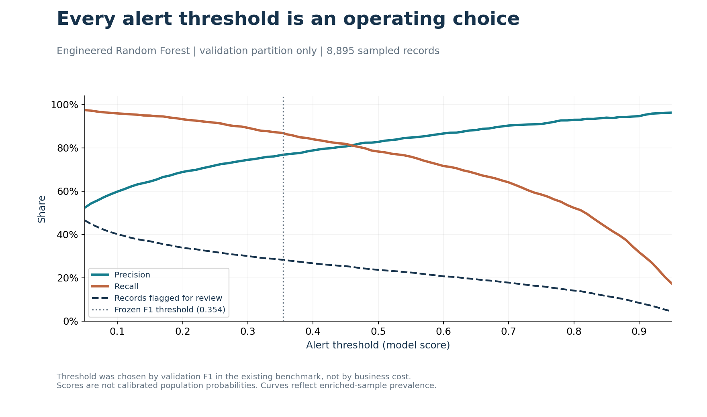
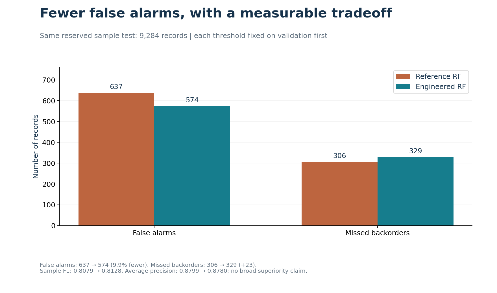
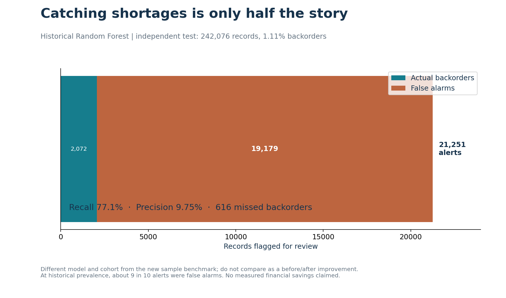
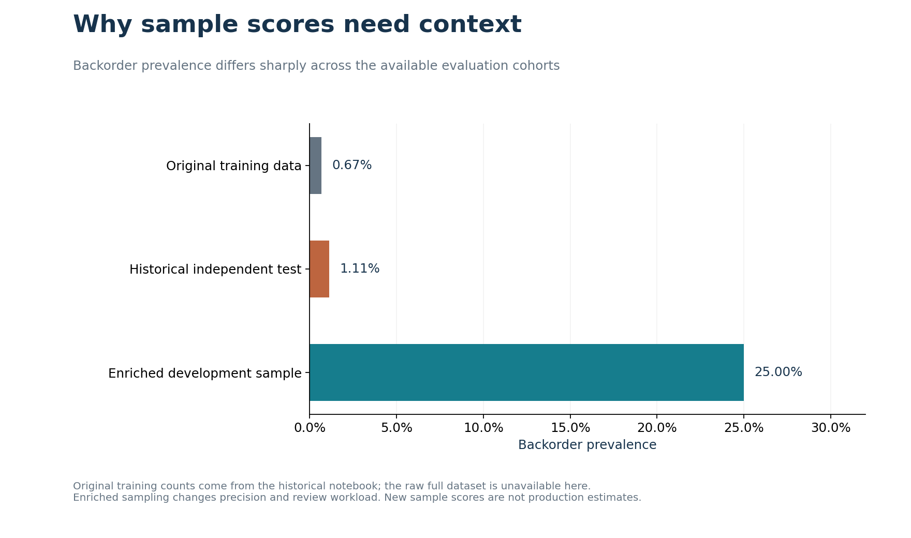

# Backorder prediction: visual findings

Five reusable figures connect inventory analysis to operational decisions. Each is available as a high-resolution PNG and editable SVG. No customer records, source rows, or model binaries are published.

## 1. Where inventory falls short



**Question:** How does observed backorder share vary when stock plus incoming inventory does not cover the three-month forecast?

The three mutually exclusive groups use `forecast_3_month` versus `national_inv + in_transit_qty`. “No positive stock” also requires forecast to exceed stock plus transit. Counts show the denominator behind each percentage. This is a descriptive association within the enriched sample, not a causal finding or estimate of population risk.

## 2. Alert threshold tradeoffs



**Question:** How much precision and recall do we trade for a smaller review queue?

Curves use only the 8,895-row validation partition. The dotted line marks the threshold already selected by validation F1. These are model scores, not calibrated real-world probabilities. The threshold does not represent an economically optimal policy: shortage costs, false-alarm costs, and team capacity were not supplied.

## 3. Model error comparison



**Finding:** On the same 9,284 reserved sample records, the engineered Random Forest produced 63 fewer false alarms and 23 more missed backorders. F1 increased modestly; average precision decreased slightly. These results establish a measured tradeoff, not statistical significance or general superiority.

## 4. Historical alert workload



**Finding:** The historical independent-test model caught 2,072 backorders but created 19,179 false alarms. Its 77.1% recall comes with 9.75% precision. This is a different model and cohort from the new experiment and must not be presented as a direct before/after comparison.

## 5. Sampling and prevalence



**Finding:** The development sample contains 25% backorders, compared with roughly 0.67% in historical training data and 1.11% in the historical independent test. Precision and workload measured on the enriched sample should not be transferred to deployment.

## Reproduce

From the repository root, after installing `requirements.txt`:

```bash
python scripts/build_visualizations.py --sample /path/to/trusted/sample-data.pkl
```

Only deserialize trusted pickle files. The source is intentionally excluded from GitHub; see [DATA.md](../../DATA.md). The script checks the sample SHA-256, reconstructs the existing grouped partitions and engineered Random Forest, and asserts that reserved-test precision, recall, F1, average precision, and confusion counts match the frozen benchmark before exporting. No new model or threshold selection is performed. `chart_data.json` contains descriptive aggregates and validation threshold metrics for reuse.

The uploaded sample was already preprocessed; inherited leakage and sampling limitations remain. These charts do not establish production readiness or financial savings. Raw source data, untouched evaluation data at natural prevalence, and operational cost assumptions are needed for that next stage.
